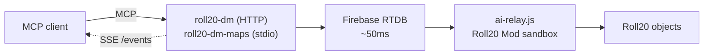

# roll20-dm-mcp

MCP servers that drive a **Roll20** table: hit points, conditions, initiative, dice, narration,
areas of effect, dynamic-lighting walls, tokens and maps. Any MCP client can call them as tools
during a live game.

Two servers, one job each:

- **`roll20-dm`** — live combat, over HTTP. HP and conditions, initiative and turn order, dice,
  narration, AoE resolution, zones, stored plans and values, the DM inbox, and an SSE event stream.
- **`roll20-dm-maps`** — map prep, over stdio. Battlemap upload and placement, wall detection,
  dynamic-lighting walls and doors, page creation, token creation.

## How a tool call reaches the table



The Mod script executes most actions; the realtime database just carries them. Some reads and
writes go straight to the database without troubling the Mod.

If the connection fails, you get an error saying what to do.

## Credentials

The servers read two files from the data dir.

| file (in the data dir) | what it is | lifetime |
|---|---|---|
| `roll20-rt-token.json` | the realtime credential — **campaign-scoped**, carries that campaign's database shard | until revoked, or ~1 h for a one-shot token |
| `roll20-upload-cache.json` | Roll20 session cookies and User-Agent, for art upload | 8 h |

When one is missing, stale, or belongs to a different campaign, you get a typed error
(`Roll20TokenUnavailableError`, `Roll20UploadCredentialError`) that names what to refresh.

**`npm run furnish:token` furnishes both.** One Console paste and one terminal paste store a refresh
token, so restarts need no new capture. It is a long-lived login that a Roll20 sign-out doesn't end,
so treat it like a password; see [docs/security.md](docs/security.md). `--upload` adds the art-upload
cookies from a copied browser request. Steps are in [docs/setup-guide.md](docs/setup-guide.md).

## Quick start

```bash
npm install          # Node 20+
npm run serve        # roll20-dm on http://127.0.0.1:39200/mcp (+ /events)
npm run build        # required for the stdio maps server
```

First run generates `ROLL20_MCP_TOKEN` into `.env`. Register a campaign, furnish a token, and deploy
the Mod relay. The full walkthrough is in **[docs/mcp-setup-for-dms.md](docs/mcp-setup-for-dms.md)**
(DM-facing) or **[docs/setup-guide.md](docs/setup-guide.md)** (developer-facing).

`ANTHROPIC_API_KEY` is needed only by the maps server's `analyze_battlemap`.

## Deploying the Mod relay

`mod-scripts/ai-relay.js` runs inside Roll20's API sandbox, and a change to it takes effect only
once deployed. **You deploy it by hand:** run `npm run build:mod`, then paste
`mod-scripts/.ai-relay.deploy.js` into the campaign's *Settings → API Scripts* and save.

- **Verify the load, not the save.** The Mod console must print
  `[GM_AI_Bridge] Relay script loaded (v2.11.0)`. A successful paste is not a running script.
- **Deploys are per-campaign.** Each campaign carries its own copy, so one table can be running an
  older relay than another. A mismatch is reported through `transport_status`.

## What the servers expose

**`roll20-dm`** — tokens and HP (`update_token_hp`, `update_hp_many`, `kill_token`, `revive_token`,
`set_pc_dying`, `set_bar`), named values (`set_token_value`, `get_token_value`), conditions and
markers (`set_token_marker`, `break_concentration`), initiative (`roll_initiative`, `set_initiatives`,
`update_turn_order`, `inject_round_marker`, `advance_turn`), dice (`roll_dice`,
`post_roll_as_character`), AoE (`resolve_aoe`, `find_tokens_in_range`) and zones, character-sheet
reads and writes, stored plans (`set_mob_plan`, `get_mob_plans`, `clear_mob_plans`), the DM inbox,
narration and whispers, `batch_exec`, and campaign management.

**`roll20-dm-maps`** — `analyze_battlemap`, `setup_roll20_page`, `upload_and_place_map_image`,
`auto_place_dl_walls`, `decorate_openings`, `place_polyline_walls`, map pins, token creation, layer
and FX tools, and `batch_import_maps`.

The HP tools route three ways: **PCs** track HP in a GM-only notes block and never touch their token
bar, **NPCs** use `bar1`, and **sidekicks** are player-controlled but route as NPCs through a registry
override. Tools pick the path; callers don't. For anything other than D&D 5e HP, `set_bar` changes a
bar with no game rules attached.

### The event stream

`GET /events` (bearer auth) is a Server-Sent Events stream: `combat-update`, `chat-message` (every
live table message and `!`-command, forwarded raw), `mob-plan` (`plan: null` means cleared),
`inbox-item`, `map-ping`, `sandbox-status`. A client can follow the table with it instead of polling.

## Development

```bash
npm test             # vitest — includes a Roll20 Mod emulator that runs the real ai-relay.js
npm run lint
```

The emulator loads `mod-scripts/ai-relay.js` into a Node `vm` with a fake Roll20 API, so relay
behaviour is testable without a live game.

Start with **[CLAUDE.md](CLAUDE.md)**: it's the orientation doc, and it documents the gotchas that
have actually bitten this project.

Deep dives live in [docs/](docs/): architecture decisions, the realtime protocol, API coverage,
security, and choreography.

## License

MIT — see [LICENSE](LICENSE) and [NOTICE](NOTICE).
